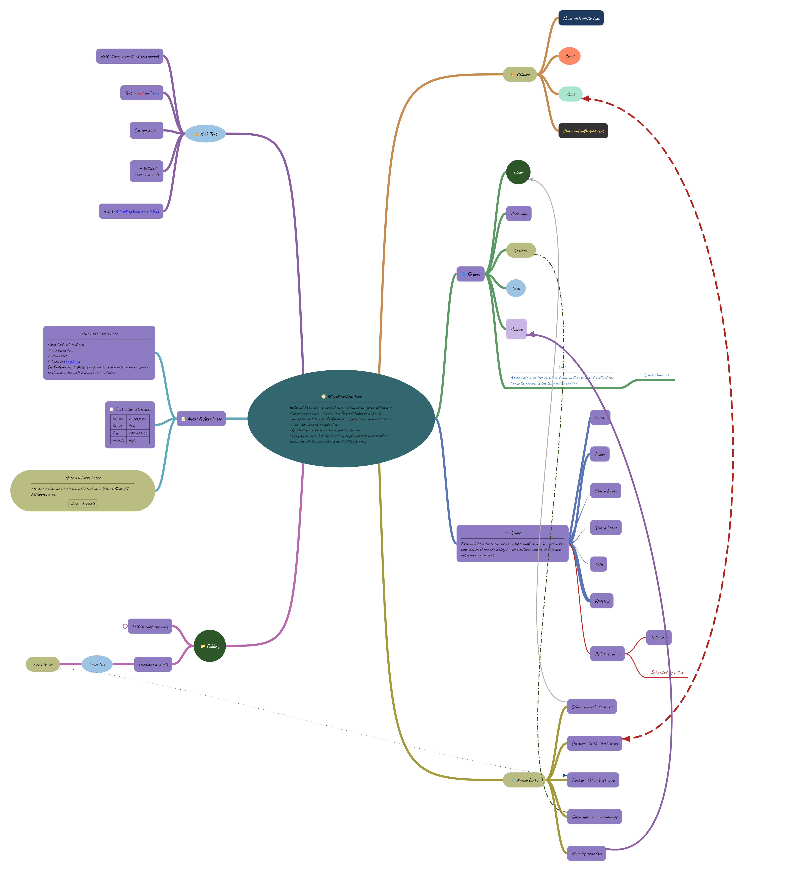

# MindMapView

You can easily draw mind maps. It allows for node creation, deletion, as well as zooming and moving.

**[Try it in your browser](https://corbettcode.github.io/MindMapView/)**: the desktop app, running as a web page.

**[User manual (PDF)](desktop/manual/MindMapView-User-Manual.pdf)**: how to use the app, also in its Help menu. It is
written in [`docs/user-manual/user-manual.html`](docs/user-manual/user-manual.html); run
`docs/user-manual/make-pdf.sh` after changing it to print the PDF again.



The map above is [`desktop/feature_tour.mmv`](desktop/feature_tour.mmv): open it in the app to explore each feature.

```
dependencyResolutionManagement {
  repositoriesMode.set(RepositoriesMode.FAIL_ON_PROJECT_REPOS)
  repositories {
    mavenCentral()
    maven { url 'https://jitpack.io' }
  }
}
```

```
dependencies {
  implementation 'com.github.hegleB:MindMapView:0.1.0'
}
```

## Funtions
- zoom, move
- Fix your window
- remove nodes
- add nodes
- edit node text

|Add|Remove|Edit|Move|Zoom and Fit Window|
|---|---|---|---|---|
||||||

## Compose Multiplatform
The library is a Kotlin Multiplatform library built on Compose Multiplatform. It supports Android, Desktop (JVM), iOS (`iosArm64`, `iosSimulatorArm64`) and Web (`wasmJs`).

```kotlin
kotlin {
    sourceSets {
        commonMain.dependencies {
            implementation("com.github.hegleB:MindMapView:<version>")
        }
    }
}
```

```kotlin
@Composable
fun MindMapScreen() {
    val state = rememberMindMapState()

    Column {
        Row {
            Button(onClick = { state.addNode("new node") }) { Text("Add") }
            Button(onClick = { state.editNodeText("edited") }) { Text("Edit") }
            Button(onClick = { state.removeNode() }) { Text("Remove") }
            Button(onClick = { state.fitScreen() }) { Text("Fit") }
        }
        MindMap(
            state = state,
            modifier = Modifier.fillMaxSize(),
            onNodeClick = { node -> /* node is null when empty space is touched */ },
            onNodeMove = { tree, target, parent -> /* target was attached to parent */ },
        )
    }
}
```

- `addNode`, `editNodeText` and `removeNode` act on the selected node (`state.selectedNode`).
- `editNodeShape` gives the selected node another shape and keeps the rest of it. The root stays an oval.
- `addSiblingNode` adds a node next to the selected one, under the same parent and on the same side of the root: right after it, or right before it with `isAbove = true`. The root has no siblings, so for the root it adds a child, as `addNode` does. Like `addNode`, it leaves the selected node selected, and `getAddNode()` returns the added one.
- A node's text can be typed on the map itself, in a text field over the node in its own font, size and color that moves and zooms with the map. `state.startTextEdit()` starts typing into the selected node, and `state.startTextEdit(text)` replaces its text with `text` first, for typing started with a letter. `state.addNodeForTextEdit { addSiblingNode("Topic 3") }` adds a node, as the block adds it, selects it and starts typing into it. While a node is typed into, `state.textEditNodeId` is its id and the node grows with its text. `state.commitTextEdit()` ends the typing as one change to undo, together with the node added for it, and `state.cancelTextEdit()` puts the map back as it was. Text that shows nothing is cancelled, so the root is never left without text. Selecting another node, undoing, any other change, or a press on the map ends the typing first. In the text field Enter ends it, Escape cancels it, Shift+Enter starts a new line, and Ctrl+B, Ctrl+I and Ctrl+U make the selected text bold, italic or underlined; an app that takes those keys before the text field does decides what they do. In the desktop app, Tab adds a child and Enter a sibling below (Shift+Enter above) and types its text, and Tab while typing ends it and adds a child. F2, a double click or a letter types into the selected node, and Escape cancels.
- `rememberMindMapState()` places the root node at the center of the mind map. Pass `Tree<Any>(Dp(x), Dp(y))` to choose the position yourself.
- The root has six sets of children, one for each `LayoutSide`: `LEFT` and `RIGHT` straight out of it, and `UPPER_LEFT`, `UPPER_RIGHT`, `LOWER_LEFT` and `LOWER_RIGHT` out along a line 60 degrees above or below the horizontal, so the six sides and their add buttons are evenly spaced around the root, kept clear of the set straight out to the same side. The nodes below a child of the root grow out to its left or right. The root has an add button for each set, and a node dropped on the root joins the set nearest to where it was dropped. `addNode` takes the `side` a child of the root is added to, which defaults to `state.layoutSide`. Setting `state.layoutSide` also moves every child of the root to that side, `state.moveNodeToOtherSide()` moves a branch across to the other side at the same height, and `state.moveNodeAround(isClockwise)` moves it to the next side round the root, as its add buttons go.
- Pass `onAddChildClick` to `MindMap` to draw a '+' button on the selected nodes and the node under the mouse pointer, where its lines to its children start; the root gets one on each side. Clicking it selects that node and calls `onAddChildClick` with the node and the side, so a following `addNode` with that side adds the child there.
- Each line from the root to one of its children is drawn in its own color, which the lines and '+' buttons of the branch below it share.
- `DescriptionEmoji.prepend(emoji, description)` puts an emoji in front of a description and `DescriptionEmoji.split(description)` finds it again, for an emoji picker in an edit dialog.
- Drag the root to move it, and the tree with it. A root that is given no position is kept in the center of the mind map, whatever size that takes, until it is dragged.
- Drag a node onto the root to move it to the side of the root nearest to where it is dropped, or call `state.moveNodeAround(isClockwise)` to move the branch the selected node is in, the child of the root it is or is below, to the next side round the root. In the desktop app, Ctrl+M moves it clockwise and Ctrl+Shift+M counterclockwise. Pressing '+' does what clicking the selected node's '+' button does; for the root, that is the button of `state.layoutSide`. Pressing Alt+Enter opens the edit dialog of the selected node. The arrow keys select the nearest node that way on the screen, preferring one level with the selected node: `state.selectNodeInDirection(direction)`. Ctrl+Left selects the parent of the selected node, towards the root, and Ctrl+Right its first child, down the branch: `state.selectParent()` and `state.selectFirstChild()`. Ctrl+Down and Ctrl+Up select the next and the previous child of the same parent, other than the root: `state.selectSibling(isNext)`.
- A description or a note may hold links, as HTML `<a href>` elements. Pass `onLinkClick` to `MindMap` to be told of a click on a link in the text of a node; `RichText.links(html)` lists the links in a description or a note.
- A node with children can be folded, as in FreeMind, which hides the nodes below it: `state.toggleFold()` folds or unfolds the selected node and `state.toggleChildrenFold()` its children, `state.foldOneLevel()` and `state.unfoldOneLevel()` hide or show one level of the nodes below it, and `state.foldAll()` and `state.unfoldAll()` all of them. A folded node has a ring where its lines would start, and a click on the ring unfolds it. The root is never folded. `FreeMind` reads and writes the folds as `FOLDED="true"`.
- An arrow link is an arrow from one node to any other, drawn as a curve on top of the tree: `state.addArrowLink(sourceId, targetId)` adds one, `state.updateArrowLink` changes its color and arrowheads and `state.removeArrowLink` removes it. `MindMap` calls `onArrowLinkMenu` when one is clicked with the secondary mouse button, for showing a menu there. Dragging a node onto another with Ctrl held down adds an arrow link from the first to the second, or removes it when it is there already, and calls `onNodeLink`.
- A click on a node with the secondary mouse button selects it and calls `onNodeMenu`, for showing a menu of the node there.
- A boundary is an outline around some of the children of one node and the nodes below them, as XMind's boundaries and FreeMind's clouds are: `Boundary(id, parentId, childIds, color, style, isFilled)`, where a null `color` is that of the branch. `state.addBoundary()` adds one around the selected nodes, one for each parent and side of the root they are on, as one step that can be undone, and `state.updateBoundary` and `state.removeBoundary` change or remove one. A boundary is around its children and those between them, and those that are removed or moved away leave it; one with none left goes. It is drawn behind the lines and nodes, in the exports too, and the layout leaves room around it. `MindMap` calls `onBoundaryMenu` when one is clicked with the secondary mouse button where there is no node, for showing a menu there. In the desktop app, Ctrl+B adds one. `MindMapViewFile` keeps boundaries, `FreeMind` keeps each as a cloud around each of its nodes, and `XMind` reads them.
- A summary is a node that sums up some of its siblings, drawn past them and centered on them with a bracket to them, in place of a line from their parent, as XMind's and Freeplane's summaries are. `state.addSummaryNode(description, shape, ...)` adds one after the selected nodes, one for each parent and side of the root they are on, as one step that can be undone; inside `state.addNodeForTextEdit { }` its text is typed at once. `tree.isSummary(id)`, `tree.summaryChildIds(id)` and `tree.summaries` tell which nodes are summaries and what of, and `tree.setSummary` and `tree.removeSummary` make a node one or an ordinary node again. A summary is about its siblings and those between them, on its side of the root, but no summary; one with none of them left, or moved under another node, is an ordinary node again. It is otherwise an ordinary child of its parent, so it is found, copied, exported and folded as any node is. In the desktop app, Ctrl+] adds one and types its text. `MindMapViewFile` keeps summaries, `FreeMind` keeps them as Freeplane does, and `XMind` reads them.
- A node can be a task: `tree.taskOf(id)` is its `NodeTask(priority, progress, start, due)`, with a priority from 1 to 9, a `TaskProgress` from `NOT_STARTED` through quarters to `DONE`, and `TaskDate` start and due days. `state.setPriority`, `state.setProgress` and `state.toggleDone` change the selected nodes, and `state.setDates(start, due)` the selected nodes' dates, and `state.editNodeTask(id, task)` one node, each as one step that can be undone. The priority and progress are drawn as badges in front of the text, and a click on the progress takes it a step on. The due date is a line below the text, written by `MindMap(dateLabel = …)`, and red when `state.isOverdue(id)`: due before `state.today`, which the app sets, as the library reads no clock. `MindMapViewFile` keeps tasks, `FreeMind` writes them as FreeMind's and Freeplane's icons with the dates as `start` and `due` attributes, `Markdown` as task list items, `Opml` as `_priority`, `_progress`, `_start` and `_due`, and `XMind` reads its priority and task markers as tasks. In the desktop app, Ctrl+1 to Ctrl+9 set the priority, Ctrl+0 takes it away, Ctrl+D toggles done, and the edit dialog picks the start and due dates.
- A node may have attributes, names with a value each, which are drawn as a table below its text when they are shown inline, and as an icon otherwise. `state.attributeDisplay` is how they are shown, `AttributeDisplay.HIDDEN`, `FLYOVER` or `INLINE`, where a node has no way of its own; `state.editNodeAttributeDisplay(attributeDisplay)` gives the selected node its own way, or with null makes it follow the map again, and `state.attributeDisplayOf(id)` tells how a node's attributes are shown: its own way, else that of its kind of topic in `state.topicAttributeDisplays`, else `state.attributeDisplay`. In the desktop app, the Attributes section of the edit dialog has a Display choice, whose Default follows the Preferences of the node's kind of topic. `state.attributeMarkerNode` is the node whose icon the mouse is over. `state.editNodeAttributes(attributes)` gives them to the selected node and `state.tree.attributesOf(id)` returns them.
- Changes to the map can be undone and redone: `state.undo()` puts the map back as it was before the last change and `state.redo()` makes it again, while `state.canUndo` and `state.canRedo` tell whether there is one. Adding, removing, editing, moving, pasting, folding and arrow links are each one step, as is a drag that re-attaches a node or moves the root; selecting, zooming and moving the view are not changes. `state.groupChanges { }` makes several changes one step, and `setTree` forgets what there was to undo.
- `state.isModified` tells whether the map is another one than when `state.markSaved()` was called last, or `setTree` when that was later, to save its changes before they are lost. Only what a FreeMind file holds counts, not where the nodes are, so undoing the changes since leaves it unmodified again.
- `state.noteDisplay` is how the notes are shown, `NoteDisplay.HIDDEN`, `FLYOVER` or `INLINE`, where a node has no way of its own; inline, a note is a paragraph below the text of its node. `state.editNodeNoteDisplay(noteDisplay)` gives the selected node its own way, or with null makes it follow the map again, and `state.noteDisplayOf(id)` tells how a node's note is shown: its own way, else that of its kind of topic in `state.topicNoteDisplays`, else `state.noteDisplay`. The library only draws inline notes; showing a flyover note in a popup is up to the app, and `state.noteMarkerNode` is the node whose note icon the mouse is over. In the desktop app, the Note section of the edit dialog has a Display choice, whose Default follows the Preferences of the node's kind of topic.
- `state.findNodes(text)` returns the nodes whose description or note holds the text, ignoring case, in the order of the tree. The text a node shows is searched, not its markup, and nodes hidden in a folded node are found too: `state.goToNode(id)` unfolds the nodes above one to show it.
- `state.exportImage()` returns the whole mind map as an `ImageBitmap`, whatever part of it is in view: the nodes that are shown, their lines and their arrow links, in the colors of its theme, on its background, at 2 pixels a dp unless `pixelsPerDp` says otherwise. An image whose largest side would be more than `maxSide` pixels is made smaller. It is null until the mind map is shown.
- A map has a theme, `state.tree.theme`, which `state.setTheme(theme)` changes as one step that can be undone. `MapThemes.all` lists the themes that come with the library, `MapThemes.CLASSIC` first, and `MapThemes.byId(id)` finds one. A `MapTheme` gives the background, the fill, text color and border of the root, the main topics and the nodes below them (`theme.levelStyleOf(kind)`), the text color of line nodes, the colors of the lines from the root in turn, the line width, a font name, the colors offered for an arrow link, the shapes new topics and subtopics are added in (`theme.newNodeShapeOf(kind)`), and how notes and attributes are shown; each of the last is optional. A node follows the theme for as long as its colors are the ones its shape starts with (`tree.defaultFillOf(node)`); a color, border or line it is given is kept in every theme. `tree.fillOf(id)`, `tree.textColorOf(id)` and `tree.drawnBorderOf(id)` say how a node is drawn. The map is drawn on the theme's background, or on `state.backgroundColor` when that is set, whether the app is light or dark, and `MindMapViewFile` saves the theme as `theme="<id>"`; a file without one is in the Classic theme. In the desktop and web app, Preferences › Map theme changes the open map's theme and the one new maps start in, and fills the other preferences in from the theme.
- Each node has a level: `tree.levelOf(id)` is 0 for the root, 1 for its children, 2 for theirs and so on, worked out from where the node is, so it follows a node that is moved. `tree.topicKindOf(id)` names it by its level, a `TopicKind`: `ROOT_TOPIC` on level 0, `TOPIC` on level 1 and `SUBTOPIC` below, and `tree.childTopicKindOf(parentId)` is the kind of a node added there. `state.topicStyles` draws each kind in a `LevelStyle` of the app's own in place of the theme's, for the nodes that follow the theme, and `MindMap(topicFontFamilies = ...)` draws the text of each kind in a font of its own. These are the app's, not the map's: they are not undone, and they stay for a map opened with `setTree`. In the desktop and web app, Preferences has a section for each kind, with its font, shape, ways of showing notes and attributes, colors and border.
- `state.exportSvg()` returns the whole mind map as an SVG document, drawn as `exportImage` draws it, at one pixel a dp. Its text is text, in the fonts it is drawn in, so it can be searched and selected. It is null until the mind map is shown, and on Android, where Compose does not draw with Skia.
- Drag empty space to move, pinch or use the mouse wheel to zoom, and drag a node onto another node to re-attach it.

### MindMapView files
`MindMapViewFile` converts a tree to and from the text of a `.mmv` file, this library's own format, which keeps all there is of a mind map: the shapes, colors, rich text, notes and attributes and how they are shown, and folds of the nodes, the side of the root each of its children is on, the arrow links, and where the root is when it was dragged. Reading and writing the file itself is up to the app.

The app's preferences can be stored in the file too, as names and values the library leaves to the app: `MindMapViewFile.write(tree, preferences = ...)` writes them, and `MindMapViewFile.readPreferences(content)` returns them, or null for a file without any. The desktop and web app saves the preferences of how the map looks with it, and opening the map brings them back; a map saved before takes those of its theme.

The images of the text and notes can be stored in the file too, so a map shows them without the web: `MindMapViewFile.write(tree, images)` takes the bytes of each image by its address, and `MindMapViewFile.readImages(content)` returns them. The HTML keeps the addresses. The desktop and web app stores the images of a map each time it is saved.

```kotlin
val content = MindMapViewFile.write(state.tree)

state.setTree(MindMapViewFile.read(content))
state.animateTreeChange() // only a dragged root's position is stored, so arrange the tree
```

The desktop app saves to `.mmv` files. Tool › Import › Folder... makes a map of a folder on the computer, with a node for each folder in it, built with `Outline.toTree(OutlineItem(...))`, which makes a map of any hierarchy of names. It also opens FreeMind `.mm` files, which are saved as a `.mmv` file next to them, and can export a map to one. It exports a map as a PNG image, an SVG drawing, a PDF document, an HTML outline, an OPML outline, Markdown or a FreeMind map. The PDF is made from the SVG drawing by Apache FOP, with the fonts of the app and of the computer embedded; color emoji are left blank in it, as a PDF font cannot hold their pictures.

### FreeMind files
`FreeMind` converts a tree to and from the text of a FreeMind `.mm` file. Reading and writing the file itself is up to the app. FreeMind only has a left and a right side, so a child of the root above or below it is written as on the left or right.

```kotlin
val content = FreeMind.write(state.tree)

state.setTree(FreeMind.read(content))
state.animateTreeChange() // positions are not stored in the file, so arrange the tree
```

FreeMind's own `<font>` of a node is read as the style of all of its text: bold, italic, and the nearest size text can have, of which FreeMind's 12 points are the normal one. The name of its font is not kept. The style is saved as the rich text of the node, as a style chosen in an editor is.

`HtmlOutline.write(tree)` writes a tree as a web page of nested lists, with the notes and attributes of the nodes. A node with children folds in a browser, and starts out folded as it is in the tree.

`Opml.write(tree)` writes a tree as an OPML 2.0 outline, which outliners such as Workflowy, OmniOutliner and Logseq read. The text of each node is written without its formatting, its note as plain text in `_note`, and its attributes as attributes of its outline, with names made valid in XML.

`Markdown.write(tree)` writes a tree as a Markdown document that `Markdown.read` reads back as the same tree: the root and the two levels below it as headings, the nodes below those as nested list items, and notes as paragraphs, with bold, italic, struck-through text and links. Markdown cannot hold all of a mind map, so:
- Children with attributes and no children of their own are written as rows of a table, which come back first among their siblings and without their notes.
- The attributes of a node with children are left out.
- A line break or list in the text of a node is written on one line, and a backtick as an apostrophe.
- Shapes, colors, borders, lines, arrow links, folds and the sides of the root are left out.

## Sample apps
- Android: `./gradlew :app:installDebug`
- Desktop: `./gradlew :desktop:run`
- Web: `./gradlew :desktop:wasmJsBrowserDevelopmentRun` runs the desktop app in a browser. It is published at
  https://corbettcode.github.io/MindMapView/.

### Publishing the web app
`./gradlew :desktop:wasmJsBrowserDistribution` writes the app as a static web site to
`desktop/build/dist/wasmJs/productionExecutable`. Any static host can serve that folder (GitHub Pages, Netlify, an
S3 bucket), as long as it serves `.wasm` files as `application/wasm`. It needs a browser with WebAssembly garbage
collection: Chrome or Edge 119, Firefox 120, Safari 18.2 or later.

The `Web app` workflow (`.github/workflows/web.yml`) builds the site and publishes it on GitHub Pages at each push
to main. Pages has to be turned on once, with GitHub Actions as its source (Settings → Pages → Source).

In the browser the app works as on the desktop, except:
- In Chrome and Edge, Save writes back to the file that was opened. Other browsers download the map instead.
- In Chrome and Edge, the Recent menu lists the maps opened or saved last, by name: a web page is not told which
  folder a file is in. The browser asks to allow the file again before it opens. Other browsers have no Recent menu.
- Pasting text from other programs asks for the browser's permission first.
- A note's images only show when their site allows other sites to load them.
- Preferences are kept in the browser's local storage.
- Some shortcuts, such as Ctrl+N, belong to the browser; use the menus for those.
- There is no PDF export. Open the exported SVG drawing in the browser and print it to a PDF instead.

## Android View
`MindMapView` is still available on Android as a View that hosts the composable.

1. Add the MindMapView to your XML layout
```kotlin
<com.mindsync.library.MindMapView
    android:id="@+id/mind_map_view"
    android:layout_width="0dp"
    android:layout_height="0dp"
    app:layout_constraintBottom_toBottomOf="parent"
    app:layout_constraintEnd_toEndOf="parent"
    app:layout_constraintStart_toStartOf="parent"
    app:layout_constraintTop_toTopOf="parent" />
```

2. Define Node Classes
```kotlin
sealed class Node(
    open val id: String,
    open val parentId: String?,
    open val path: NodePath,
    open val description: String,
    open val children: List<String>,
) {
    abstract fun adjustPosition(
        horizontalSpacing: Dp,
        totalHeight: Dp,
    ): Node
}

data class CircleNode(
    override val id: String,
    override val parentId: String?,
    override val path: CirclePath = CirclePath(Dp(0f), Dp(0f), Dp(0f)),
    override val description: String,
    override val children: List<String>,
) : Node(id, parentId, path, description, children) {
    override fun adjustPosition(
        horizontalSpacing: Dp,
        totalHeight: Dp,
    ): Node {
        return this.copy(path = path.adjustPath(horizontalSpacing, totalHeight))
    }
}

data class StadiumNode(
    override val id: String,
    override val parentId: String?,
    override val path: StadiumPath = StadiumPath(Dp(0f), Dp(0f), Dp(0f), Dp(0f)),
    override val description: String,
    override val children: List<String>,
) : Node(id, parentId, path, description, children) {
    override fun adjustPosition(
        horizontalSpacing: Dp,
        totalHeight: Dp,
    ): Node {
        return this.copy(path = path.adjustPath(horizontalSpacing, totalHeight))
    }
}

data class OvalNode(
    override val id: String,
    override val parentId: String?,
    override val path: OvalPath = OvalPath(Dp(0f), Dp(0f), Dp(0f), Dp(0f)),
    override val description: String,
    override val children: List<String>,
) : Node(id, parentId, path, description, children) {
    override fun adjustPosition(
        horizontalSpacing: Dp,
        totalHeight: Dp,
    ): Node {
        return this.copy(path = path.adjustPath(horizontalSpacing, totalHeight))
    }
}

data class RectangleNode(
    override val id: String,
    override val parentId: String,
    override val path: RectanglePath = RectanglePath(Dp(0f), Dp(0f), Dp(0f), Dp(0f)),
    override val description: String,
    override val children: List<String>,
) : Node(id, parentId, path, description, children) {
    override fun adjustPosition(
        horizontalSpacing: Dp,
        totalHeight: Dp,
    ): Node {
        return this.copy(path = path.adjustPath(horizontalSpacing, totalHeight))
    }
}
```

2. Initialize the Mind Map View
```kotlin
    val tree = Tree<Node>(this)
        binding.mindMapView.setTree(tree)
        binding.mindMapView.initialize()
```

3. Implement Node Click Listener
```kotlin
binding.mindMapView.setNodeClickListener(object : NodeClickListener {
    override fun onClickListener(node: NodeData<*>?) {
        val selectedNode = createNode(node)
        ...
    }
})
```

4. Create Nodes Based on User Interaction
```kotlin
fun createNode(node: NodeData<*>?): Node? {
        return when (node) {
            // A circle node, as any other node can be.
            is CircleNodeData -> CircleNode(
                node.id,
                node.parentId,
                CirclePath(
                    Dp(node.path.centerX.dpVal),
                    Dp(node.path.centerY.dpVal),
                    Dp(node.path.radius.dpVal)
                ),
                node.description,
                node.children
            )

            is RectangleNodeData -> RectangleNode(
                node.id,
                node.parentId,
                RectanglePath(
                    Dp(node.path.centerX.dpVal),
                    Dp(node.path.centerY.dpVal),
                    Dp(node.path.width.dpVal),
                    Dp(node.path.height.dpVal)
                ),
                node.description,
                node.children
            )

            is StadiumNodeData -> StadiumNode(
                node.id,
                node.parentId,
                StadiumPath(
                    Dp(node.path.centerX.dpVal),
                    Dp(node.path.centerY.dpVal),
                    Dp(node.path.length.dpVal),
                    Dp(node.path.radius.dpVal)
                ),
                node.description,
                node.children
            )

            is OvalNodeData -> OvalNode(
                node.id,
                node.parentId,
                OvalPath(
                    Dp(node.path.centerX.dpVal),
                    Dp(node.path.centerY.dpVal),
                    Dp(node.path.radiusX.dpVal),
                    Dp(node.path.radiusY.dpVal)
                ),
                node.description,
                node.children
            )

            else -> null
        }
    }
```

5. Additional View Manipulations
```
binding.mindMapView.addNode(description)
binding.mindMapView.editNodeText(description)
binding.mindMapView.editNodeNote(note)
binding.mindMapView.editNodeShape(shape)
binding.mindMapView.addArrowLink(sourceId, targetId)
binding.mindMapView.removeArrowLink(arrowLinkId)
binding.mindMapView.toggleFold()
binding.mindMapView.fitScreen()
```
