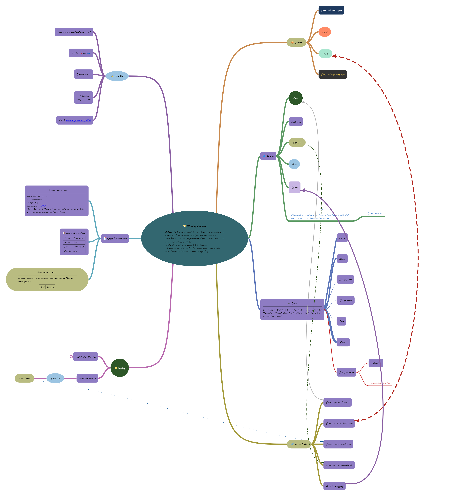

# MindMapView

You can easily draw mind maps. It allows for node creation, deletion, as well as zooming and moving.

**[Try it in your browser](https://corbettcode.github.io/MindMapView/)**: the desktop app, running as a web page.



The map above is [`desktop/feature_tour.mmv`](desktop/feature_tour.mmv): open it in the app to explore each feature.

```
dependencyResolutionManagement {
  repositoriesMode.set(RepositoriesMode.FAIL_ON_PROJECT_REPOS)
  repositories {
    mavenCentral()
    maven { url 'https://jitpack.io' }
  }
}
```

```
dependencies {
  implementation 'com.github.hegleB:MindMapView:0.1.0'
}
```

## Funtions
- zoom, move
- Fix your window
- remove nodes
- add nodes
- edit node text

|Add|Remove|Edit|Move|Zoom and Fit Window|
|---|---|---|---|---|
||||||

## Compose Multiplatform
The library is a Kotlin Multiplatform library built on Compose Multiplatform. It supports Android, Desktop (JVM), iOS (`iosArm64`, `iosSimulatorArm64`) and Web (`wasmJs`).

```kotlin
kotlin {
    sourceSets {
        commonMain.dependencies {
            implementation("com.github.hegleB:MindMapView:<version>")
        }
    }
}
```

```kotlin
@Composable
fun MindMapScreen() {
    val state = rememberMindMapState()

    Column {
        Row {
            Button(onClick = { state.addNode("new node") }) { Text("Add") }
            Button(onClick = { state.editNodeText("edited") }) { Text("Edit") }
            Button(onClick = { state.removeNode() }) { Text("Remove") }
            Button(onClick = { state.fitScreen() }) { Text("Fit") }
        }
        MindMap(
            state = state,
            modifier = Modifier.fillMaxSize(),
            onNodeClick = { node -> /* node is null when empty space is touched */ },
            onNodeMove = { tree, target, parent -> /* target was attached to parent */ },
        )
    }
}
```

- `addNode`, `editNodeText` and `removeNode` act on the selected node (`state.selectedNode`).
- `editNodeShape` gives the selected node another shape and keeps the rest of it. The root stays an oval.
- `rememberMindMapState()` places the root node at the center of the mind map. Pass `Tree<Any>(Dp(x), Dp(y))` to choose the position yourself.
- The root has six sets of children, one for each `LayoutSide`: `LEFT` and `RIGHT` straight out of it, and `UPPER_LEFT`, `UPPER_RIGHT`, `LOWER_LEFT` and `LOWER_RIGHT` out along a line 60 degrees above or below the horizontal, so the six sides and their add buttons are evenly spaced around the root, kept clear of the set straight out to the same side. The nodes below a child of the root grow out to its left or right. The root has an add button for each set, and a node dropped on the root joins the set nearest to where it was dropped. `addNode` takes the `side` a child of the root is added to, which defaults to `state.layoutSide`. Setting `state.layoutSide` also moves every child of the root to that side, `state.moveNodeToOtherSide()` moves a branch across to the other side at the same height, and `state.moveNodeAround(isClockwise)` moves it to the next side round the root, as its add buttons go.
- Pass `onAddChildClick` to `MindMap` to draw a '+' button on the selected nodes and the node under the mouse pointer, where its lines to its children start; the root gets one on each side. Clicking it selects that node and calls `onAddChildClick` with the node and the side, so a following `addNode` with that side adds the child there.
- Each line from the root to one of its children is drawn in its own color, which the lines and '+' buttons of the branch below it share.
- `DescriptionEmoji.prepend(emoji, description)` puts an emoji in front of a description and `DescriptionEmoji.split(description)` finds it again, for an emoji picker in an edit dialog.
- Drag the root to move it, and the tree with it. A root that is given no position is kept in the center of the mind map, whatever size that takes, until it is dragged.
- Drag a node onto the root to move it to the side of the root nearest to where it is dropped, or call `state.moveNodeAround(isClockwise)` to move the branch the selected node is in, the child of the root it is or is below, to the next side round the root. In the desktop app, Ctrl+M moves it clockwise and Ctrl+Shift+M counterclockwise. Pressing '+' does what clicking the selected node's '+' button does; for the root, that is the button of `state.layoutSide`. Ctrl+Left selects the parent of the selected node, towards the root, and Ctrl+Right its first child, down the branch: `state.selectParent()` and `state.selectFirstChild()`. Ctrl+Down and Ctrl+Up select the next and the previous child of the same parent, other than the root: `state.selectSibling(isNext)`.
- A description or a note may hold links, as HTML `<a href>` elements. Pass `onLinkClick` to `MindMap` to be told of a click on a link in the text of a node; `RichText.links(html)` lists the links in a description or a note.
- A node with children can be folded, as in FreeMind, which hides the nodes below it: `state.toggleFold()` folds or unfolds the selected node and `state.toggleChildrenFold()` its children, `state.foldOneLevel()` and `state.unfoldOneLevel()` hide or show one level of the nodes below it, and `state.foldAll()` and `state.unfoldAll()` all of them. A folded node has a ring where its lines would start, and a click on the ring unfolds it. The root is never folded. `FreeMind` reads and writes the folds as `FOLDED="true"`.
- An arrow link is an arrow from one node to any other, drawn as a curve on top of the tree: `state.addArrowLink(sourceId, targetId)` adds one, `state.updateArrowLink` changes its color and arrowheads and `state.removeArrowLink` removes it. `MindMap` calls `onArrowLinkMenu` when one is clicked with the secondary mouse button, for showing a menu there. Dragging a node onto another with Ctrl held down adds an arrow link from the first to the second, or removes it when it is there already, and calls `onNodeLink`.
- A click on a node with the secondary mouse button selects it and calls `onNodeMenu`, for showing a menu of the node there.
- A node may have attributes, names with a value each, which are drawn as a table below its text while `state.showAttributes` is set: `state.editNodeAttributes(attributes)` gives them to the selected node and `state.tree.attributesOf(id)` returns them.
- Changes to the map can be undone and redone: `state.undo()` puts the map back as it was before the last change and `state.redo()` makes it again, while `state.canUndo` and `state.canRedo` tell whether there is one. Adding, removing, editing, moving, pasting, folding and arrow links are each one step, as is a drag that re-attaches a node or moves the root; selecting, zooming and moving the view are not changes. `state.groupChanges { }` makes several changes one step, and `setTree` forgets what there was to undo.
- `state.isModified` tells whether the map is another one than when `state.markSaved()` was called last, or `setTree` when that was later, to save its changes before they are lost. Only what a FreeMind file holds counts, not where the nodes are, so undoing the changes since leaves it unmodified again.
- `state.findNodes(text)` returns the nodes whose description or note holds the text, ignoring case, in the order of the tree. The text a node shows is searched, not its markup, and nodes hidden in a folded node are found too: `state.goToNode(id)` unfolds the nodes above one to show it.
- `state.exportImage()` returns the whole mind map as an `ImageBitmap`, whatever part of it is in view: the nodes that are shown, their lines and their arrow links, in light colors on white, at 2 pixels a dp unless `pixelsPerDp` says otherwise. An image whose largest side would be more than `maxSide` pixels is made smaller. It is null until the mind map is shown.
- Drag empty space to move, pinch or use the mouse wheel to zoom, and drag a node onto another node to re-attach it.

### MindMapView files
`MindMapViewFile` converts a tree to and from the text of a `.mmv` file, this library's own format, which keeps all there is of a mind map: the shapes, colors, rich text, notes, attributes and folds of the nodes, the side of the root each of its children is on, the arrow links, and where the root is when it was dragged. Reading and writing the file itself is up to the app.

```kotlin
val content = MindMapViewFile.write(state.tree)

state.setTree(MindMapViewFile.read(content))
state.animateTreeChange() // only a dragged root's position is stored, so arrange the tree
```

The desktop app saves to `.mmv` files. It also opens FreeMind `.mm` files, which are saved as a `.mmv` file next to them, and can export a map to one.

### FreeMind files
`FreeMind` converts a tree to and from the text of a FreeMind `.mm` file. Reading and writing the file itself is up to the app. FreeMind only has a left and a right side, so a child of the root above or below it is written as on the left or right.

```kotlin
val content = FreeMind.write(state.tree)

state.setTree(FreeMind.read(content))
state.animateTreeChange() // positions are not stored in the file, so arrange the tree
```

FreeMind's own `<font>` of a node is read as the style of all of its text: bold, italic, and the nearest size text can have, of which FreeMind's 12 points are the normal one. The name of its font is not kept. The style is saved as the rich text of the node, as a style chosen in an editor is.

`HtmlOutline.write(tree)` writes a tree as a web page of nested lists, with the notes and attributes of the nodes. A node with children folds in a browser, and starts out folded as it is in the tree.

## Sample apps
- Android: `./gradlew :app:installDebug`
- Desktop: `./gradlew :desktop:run`
- Web: `./gradlew :desktop:wasmJsBrowserDevelopmentRun` runs the desktop app in a browser. It is published at
  https://corbettcode.github.io/MindMapView/.

### Publishing the web app
`./gradlew :desktop:wasmJsBrowserDistribution` writes the app as a static web site to
`desktop/build/dist/wasmJs/productionExecutable`. Any static host can serve that folder (GitHub Pages, Netlify, an
S3 bucket), as long as it serves `.wasm` files as `application/wasm`. It needs a browser with WebAssembly garbage
collection: Chrome or Edge 119, Firefox 120, Safari 18.2 or later.

The `Web app` workflow (`.github/workflows/web.yml`) builds the site and publishes it on GitHub Pages at each push
to main. Pages has to be turned on once, with GitHub Actions as its source (Settings → Pages → Source).

In the browser the app works as on the desktop, except:
- In Chrome and Edge, Save writes back to the file that was opened. Other browsers download the map instead.
- There is no Recent menu: a web page cannot open a file again by its path.
- Pasting text from other programs asks for the browser's permission first.
- A note's images only show when their site allows other sites to load them.
- Preferences are kept in the browser's local storage.
- Some shortcuts, such as Ctrl+N, belong to the browser; use the menus for those.

## Android View
`MindMapView` is still available on Android as a View that hosts the composable.

1. Add the MindMapView to your XML layout
```kotlin
<com.mindsync.library.MindMapView
    android:id="@+id/mind_map_view"
    android:layout_width="0dp"
    android:layout_height="0dp"
    app:layout_constraintBottom_toBottomOf="parent"
    app:layout_constraintEnd_toEndOf="parent"
    app:layout_constraintStart_toStartOf="parent"
    app:layout_constraintTop_toTopOf="parent" />
```

2. Define Node Classes
```kotlin
sealed class Node(
    open val id: String,
    open val parentId: String?,
    open val path: NodePath,
    open val description: String,
    open val children: List<String>,
) {
    abstract fun adjustPosition(
        horizontalSpacing: Dp,
        totalHeight: Dp,
    ): Node
}

data class CircleNode(
    override val id: String,
    override val parentId: String?,
    override val path: CirclePath = CirclePath(Dp(0f), Dp(0f), Dp(0f)),
    override val description: String,
    override val children: List<String>,
) : Node(id, parentId, path, description, children) {
    override fun adjustPosition(
        horizontalSpacing: Dp,
        totalHeight: Dp,
    ): Node {
        return this.copy(path = path.adjustPath(horizontalSpacing, totalHeight))
    }
}

data class StadiumNode(
    override val id: String,
    override val parentId: String?,
    override val path: StadiumPath = StadiumPath(Dp(0f), Dp(0f), Dp(0f), Dp(0f)),
    override val description: String,
    override val children: List<String>,
) : Node(id, parentId, path, description, children) {
    override fun adjustPosition(
        horizontalSpacing: Dp,
        totalHeight: Dp,
    ): Node {
        return this.copy(path = path.adjustPath(horizontalSpacing, totalHeight))
    }
}

data class OvalNode(
    override val id: String,
    override val parentId: String?,
    override val path: OvalPath = OvalPath(Dp(0f), Dp(0f), Dp(0f), Dp(0f)),
    override val description: String,
    override val children: List<String>,
) : Node(id, parentId, path, description, children) {
    override fun adjustPosition(
        horizontalSpacing: Dp,
        totalHeight: Dp,
    ): Node {
        return this.copy(path = path.adjustPath(horizontalSpacing, totalHeight))
    }
}

data class RectangleNode(
    override val id: String,
    override val parentId: String,
    override val path: RectanglePath = RectanglePath(Dp(0f), Dp(0f), Dp(0f), Dp(0f)),
    override val description: String,
    override val children: List<String>,
) : Node(id, parentId, path, description, children) {
    override fun adjustPosition(
        horizontalSpacing: Dp,
        totalHeight: Dp,
    ): Node {
        return this.copy(path = path.adjustPath(horizontalSpacing, totalHeight))
    }
}
```

2. Initialize the Mind Map View
```kotlin
    val tree = Tree<Node>(this)
        binding.mindMapView.setTree(tree)
        binding.mindMapView.initialize()
```

3. Implement Node Click Listener
```kotlin
binding.mindMapView.setNodeClickListener(object : NodeClickListener {
    override fun onClickListener(node: NodeData<*>?) {
        val selectedNode = createNode(node)
        ...
    }
})
```

4. Create Nodes Based on User Interaction
```kotlin
fun createNode(node: NodeData<*>?): Node? {
        return when (node) {
            // A circle node, as any other node can be.
            is CircleNodeData -> CircleNode(
                node.id,
                node.parentId,
                CirclePath(
                    Dp(node.path.centerX.dpVal),
                    Dp(node.path.centerY.dpVal),
                    Dp(node.path.radius.dpVal)
                ),
                node.description,
                node.children
            )

            is RectangleNodeData -> RectangleNode(
                node.id,
                node.parentId,
                RectanglePath(
                    Dp(node.path.centerX.dpVal),
                    Dp(node.path.centerY.dpVal),
                    Dp(node.path.width.dpVal),
                    Dp(node.path.height.dpVal)
                ),
                node.description,
                node.children
            )

            is StadiumNodeData -> StadiumNode(
                node.id,
                node.parentId,
                StadiumPath(
                    Dp(node.path.centerX.dpVal),
                    Dp(node.path.centerY.dpVal),
                    Dp(node.path.length.dpVal),
                    Dp(node.path.radius.dpVal)
                ),
                node.description,
                node.children
            )

            is OvalNodeData -> OvalNode(
                node.id,
                node.parentId,
                OvalPath(
                    Dp(node.path.centerX.dpVal),
                    Dp(node.path.centerY.dpVal),
                    Dp(node.path.radiusX.dpVal),
                    Dp(node.path.radiusY.dpVal)
                ),
                node.description,
                node.children
            )

            else -> null
        }
    }
```

5. Additional View Manipulations
```
binding.mindMapView.addNode(description)
binding.mindMapView.editNodeText(description)
binding.mindMapView.editNodeNote(note)
binding.mindMapView.editNodeShape(shape)
binding.mindMapView.addArrowLink(sourceId, targetId)
binding.mindMapView.removeArrowLink(arrowLinkId)
binding.mindMapView.toggleFold()
binding.mindMapView.fitScreen()
```
